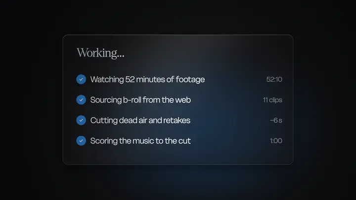
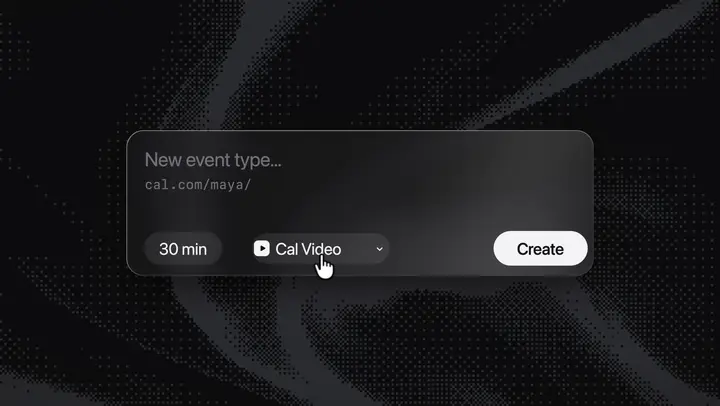
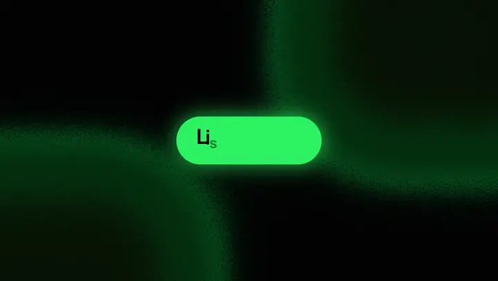
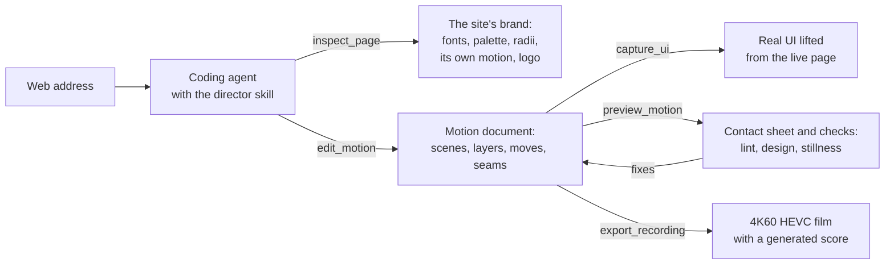

<h1 align="center">estro</h1>

<p align="center">
  <b>A macOS screen studio that turns a product's website into a launch film.</b><br>
  Record and edit your screen like Screen Studio, or give a coding agent a web address and get a 4K60 motion film back:
  the product's real UI, its fonts and colours, transitions and a score, all made on your Mac.
</p>

<table>
  <tr>
    <td width="33%"><a href="docs/media/cardboard.mp4"></a></td>
    <td width="33%"><a href="docs/media/calcom.mp4"></a></td>
    <td width="33%"><a href="docs/media/spotify.mp4"></a></td>
  </tr>
  <tr>
    <td><b>Cardboard</b>: an AI video editor's launch, 26 s<br><a href="docs/media/cardboard.mp4">▶ Watch with sound</a></td>
    <td><b>Cal.com</b>: one person's request told through the product, 34 s<br><a href="docs/media/calcom.mp4">▶ Watch with sound</a></td>
    <td><b>Spotify Jam</b>: one object morphing from state to state, 19 s<br><a href="docs/media/spotify.mp4">▶ Watch with sound</a></td>
  </tr>
</table>

Each film was made in the app from the product's website: a coding agent researched the site through estro's tools and
wrote the film as a document of scenes, moves and transitions; estro lifted the real UI from the live pages, rendered every
frame and generated the music. Not affiliated with Cardboard, Cal.com or Spotify; the films are demos made from their public
websites.

## What it does

**Records the screen.** A menu bar recorder on ScreenCaptureKit: displays, windows or an area at up to 4K60, system audio and
microphone, pause and resume, a countdown, cancel and restart. It can record an input telemetry sidecar: cursor, clicks,
scrolls and shortcuts on the video's timeline (never typed characters).

**Edits like a studio.** The editor zooms automatically on clicks, typing and where the cursor rests or circles, and redraws
the cursor smoothly from its recorded images, sharp at any zoom. It puts the recording on a canvas (background, padding,
corners, shadow) and adds click highlights and shortcut chips. It trims, splits and cuts, and exports HEVC, ProRes 4444 with
transparency, or GIF.

**Takes screenshots.** Area, window or screen, onto a floating card: copy, save, recognise text (Vision) or pin it.

**Lets coding agents use it.** An MCP server lets Claude Code, Codex, Cursor, Gemini CLI, OpenCode and Grok record web
pages, write motion videos, preview them and export the result. Settings → Agents adds it to each agent's own config.

**Makes launch films.** Type an address in the agent bar and pick an agent. It researches the product, picks a story and a
look from the brand, writes the film and renders it. You then refine it in a chat ("slower", "8 frames earlier").

## How a launch film is made



- **The director.** Every run first loads a director skill. It writes a brief from the brand and the user's words, picks one
  of six story shapes, and builds the film's biggest transitions from the product's own things: the camera flying into its
  logo or the letters of its line, a grid of its own objects turning the frame over, its button opening into the next scene.
  A random variation makes two films of one product different.
- **The checks.** `preview_motion` returns a contact sheet and findings. The lint covers reading time, a scene arriving empty
  and a ground that is too busy; design checks cover text off the frame, overlapping text, contrast and UI too small; a
  still-picture check samples the film 10 times a second and names any stretch where the picture doesn't change.

## Engineering highlights

- **A motion engine in Core Image.** Layers on planes in 3D, one camera with depth of field, keyframes or named moves (springs,
  morphs, letter-by-letter type, typing, bursts), and 32 transitions. The grounds and many transitions are Metal kernels
  compiled at run time (dither, light, smoke, liquid, a grid of the product's own mark). Motion blur takes up to 96 samples a
  frame along whatever moves. 1080p frames draw in 0.6–6.6 ms at p95 (M5, Debug build).
- **Real UI, not mockups.** Elements are lifted from live pages in an offscreen WebKit view, sharp at the scale the film shows
  them, or recorded live. The page's own clock (rAF, timers, `Date`, media) steps exactly 1/60 s a frame, so a 300 ms hover
  transition reads exactly half-way at 150 ms.
- **The score.** Synthesised on device for each film from a cue sheet built from the plan: chords on its cuts, effects on its
  clicks, typing and transitions, a room reverb by convolution, mastered to a loudness target (BS.1770-4). A 24 s film's
  score renders in about 0.4 s with vDSP.
- **The editor's renderer.** A custom `AVVideoCompositing` compositor shared by preview and export. A 4K frame with overlays
  draws in about 5 ms p50 and 8 ms p95 on an M1. The camera and cursor follow critically damped springs sampled at 120 Hz;
  HDR recordings stay HDR in HEVC and ProRes.
- **Agent bridge.** A Unix socket guarded by a per-install token; `Reco --mcp` pipes an agent's stdio to the running app and
  launches it if needed. Agent command lines run headless in the user's login environment, allowed only estro's tools (and
  read-only web search).
- **Swift 6, strict concurrency.** MVVM on `@Observable` as a functional core (pure, `Sendable` value types and functions)
  inside an imperative shell (one service per system boundary). 44k lines of Swift, and 944 tests in 16k more.

## Build and run

Requires macOS 15.2+ and Xcode 26. Sign with your own Apple Development certificate (the project carries upstream's team):

```sh
TEAM=<YOUR_TEAM_ID>   # the OU= field of: security find-certificate -c "Apple Development" -p | openssl x509 -noout -subject
xcodebuild -scheme Reco -configuration Debug -destination 'platform=macOS,arch=arm64' \
  -derivedDataPath /tmp/bc-build/dd \
  CODE_SIGN_IDENTITY="Apple Development" DEVELOPMENT_TEAM=$TEAM \
  CODE_SIGN_STYLE=Manual PROVISIONING_PROFILE_SPECIFIER="" build -quiet \
  && open /tmp/bc-build/dd/Build/Products/Debug/Reco.app
```

Run the tests with `test` in place of `build -quiet`. Launch films need [Claude Code](https://claude.com/claude-code) (or
another supported agent) on your `PATH`; then use **Record with AI Agent… → Launch Video** in the menu bar.

The app's code name is Reco. How it's built is in [`CLAUDE.md`](CLAUDE.md), the architecture in
[`docs/architecture`](docs/architecture), and every feature's design and measurements in [`docs/specs`](docs/specs).

## Credits

estro is a fork of [BetterCapture](https://github.com/jsattler/BetterCapture) by Joshua Sattler (MIT). Some of the motion
grounds are ports of [Paper Shaders](https://github.com/paper-design/shaders) (Apache-2.0). Licensed under the [MIT License](LICENSE).
